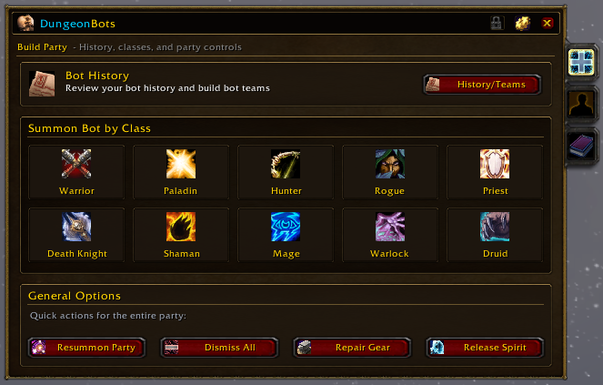
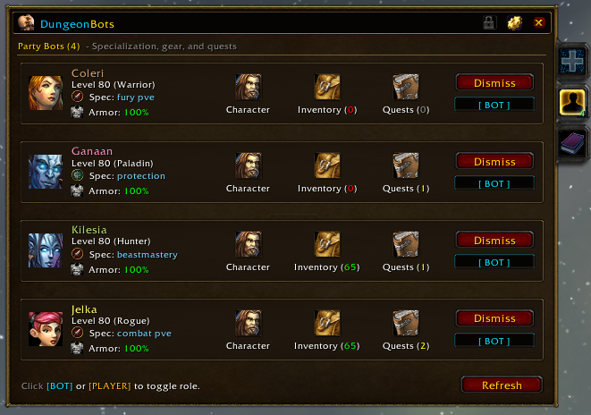
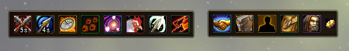
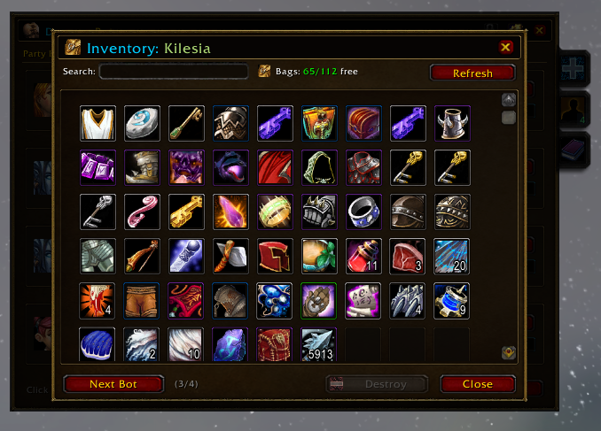

# DungeonBots

**Tactical & visual party manager for World of Warcraft 3.3.5a (`30300`) built for servers running [mod-playerbots](https://github.com/mod-playerbots/mod-playerbots/).**

Summon, organize, gear, inspect, and direct your 5-player dungeon bots from a clean Blizzard-styled UI — without typing chat commands manually.

-blue)


---

## Requirements

- **World of Warcraft 3.3.5a** client (`Interface: 30300`)
- Server with **[mod-playerbots](https://github.com/mod-playerbots/mod-playerbots/)** enabled

---

## Installation

1. Download the latest **`DungeonBots-vX.Y.Z.zip`** archive from the latest release page here:  
   **https://github.com/softkant/DungeonBots/releases/latest**
2. Extract the archive so the **`DungeonBots`** folder is placed at:
   ```text
   /Interface/AddOns/DungeonBots/
   ```
   *(Make sure `DungeonBots.toc` is inside that folder, not nested inside an extra subfolder.)*
3. Log in or type `/reload`, then open the addon with `/db` or the **minimap button**.

---

## Screenshots

### Build Party & Teams


### Party Bots & Inspection


### Floating Bars (HUD)


### Bot Inventory (Multi-Destroy)


---

## Features

### Build Party & Teams
- **Bot History & Teams:** Automatically tracks bots you group with and lets you save reusable **4-bot Teams** for fast summoning.
- **Summon by Class:** One-click summoning for all 10 classes.
- **Smart Safety:** Automatic invite for summoned bots, LFD replacement queue protection, and `[BOT]` / `[PLAYER]` tags so real friends never receive bot commands.
- **Mass Actions:** One-click **Resummon Party**, **Dismiss All**, **Repair Gear**, and **Release Spirit**.

### Individual Bot Management (`Party Bots`)
- **Character Info (`Gear`, `Spells`, `Glyphs`):** Inspect live gear, switch talent specs, trigger **Autogear** (with downgrade warnings), and cast or cancel bot spells.
- **Visual Inventory:** Bag-grid viewer with search filter, quality borders, localized tooltips, and **Left-click multi-select** to destroy multiple items in one confirmation (or **Right-click** for quick single-item destroy).
- **Quest Log & Frozen Halls Check:** Inspect active bot quests, abandon quests, and check Forge of Souls / Pit of Saron / Halls of Reflection prerequisites per bot.
- **Interactive NPC Dialog (`talk`):** Pick gossip options, accept quests, and turn in quests for each bot in party from one window.

### Floating Tactical & Utility Bars
- **Combat HUD:** Quick buttons for **Attack**, **Tank Pull** (both with configurable right-click engage delays), **Stay**, **Follow**, **Summon**, **Flee!**, **Formation Cycle**, and **Spread Out**.
- **Utility Bar:** Direct shortcuts to **Talk NPC**, **Bot Quests**, **Party Bots**, **Bot Inventory**, and **Character Info** (with proximity indicators).
- **Flexible Layout:** Drag both bars anywhere, lock/unlock them together from the header padlock, hide them individually, or show them only inside 5-player dungeons.

### Personalization & QoL
- **Visual Themes:** Switch live between **Gold** and **Slate Blue**.
- **Independent Language Selector:** Choose **Auto**, **English**, or **Español** inside Settings — works even if your WoW client uses a different language.
- **Chat Filtering:** Optionally hide incoming/outgoing bot whispers and bot party/say/yell chatter (supports Blizzard chat and WIM).
- **Built-in Guide:** 6-topic troubleshooting and Frozen Halls / instance cooldown reference tab inside the addon.

---

## Shortcuts & Slash Commands

- **Minimap Button:** Left-click to toggle main window · Right-click to toggle Tactical HUD · Drag to move.
- **LFD Integration:** Right-click the Dungeon Finder minimap eye or use the embedded **DungeonBots** button.

| Command | Action |
| :--- | :--- |
| `/db` | Toggle the main DungeonBots window |
| `/db hud` | Show or hide the Floating Tactical HUD |
| `/db talk [bot]` | Open NPC Dialog (`talk`) for a bot |
| `/db inv [bot]` | Open Bot Inventory |
| `/db spells [bot] [filter]` | Open Character Info on the `Spells` tab |
| `/db dalaran` | Trigger the Dalaran prep macro (`/p summon` + `/p accept *`) |
| `/db addall` | Recall all missing party bots |
| `/db dismiss` | Dismiss all party bots |
| `/db reset` | Reset both floating bars to their default position |
